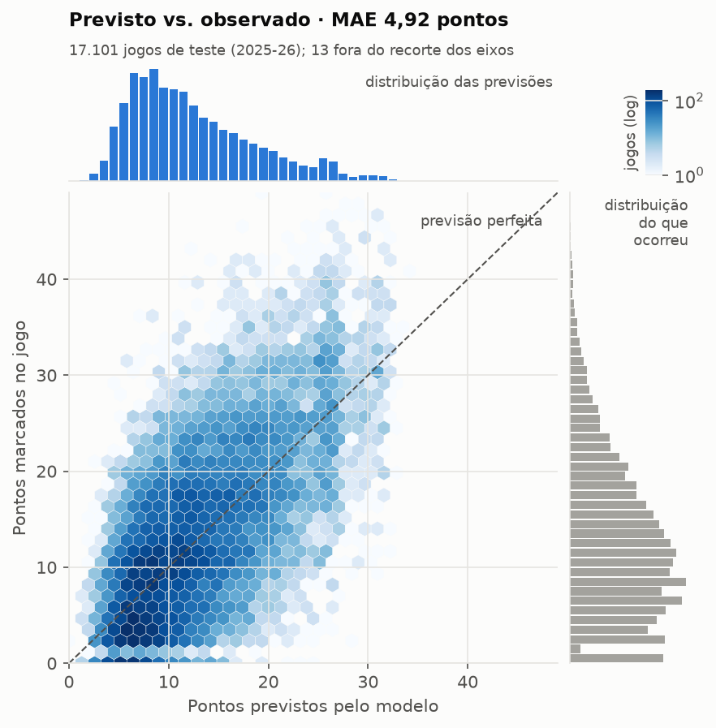
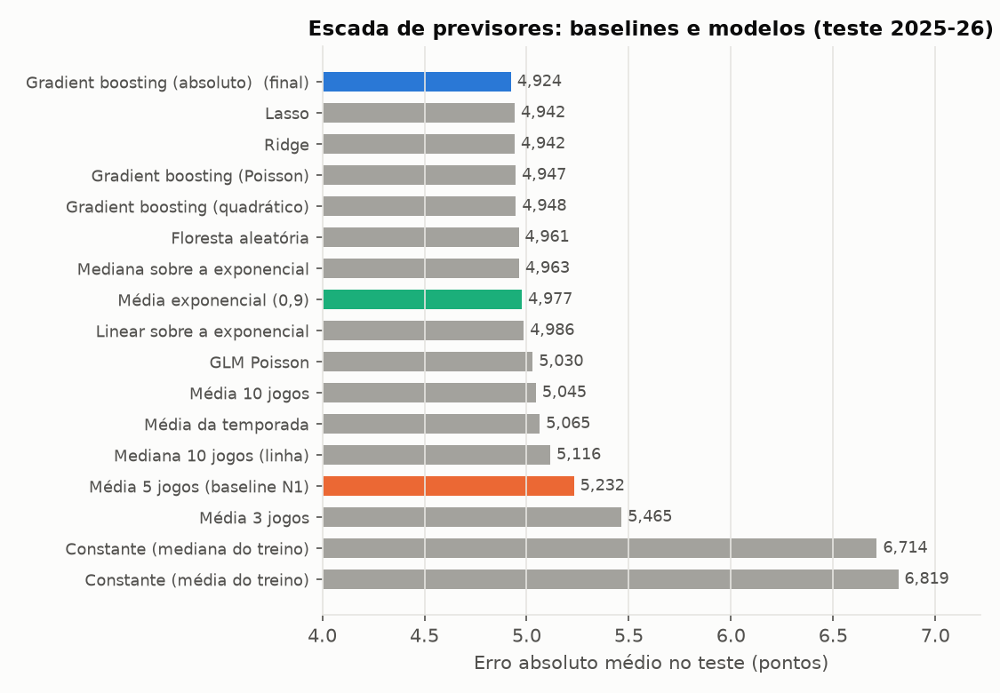
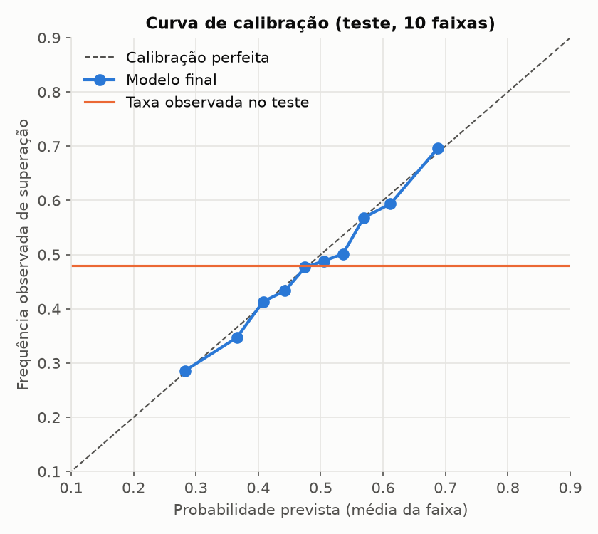

# Previsão de desempenho de jogadores da NBA

Projeto da disciplina de **Inteligência Artificial** (7º J, Sistemas de
Informação, Noite), Universidade Presbiteriana Mackenzie. Prof. Dr. Leandro
Zerbinatti.

O objetivo é prever **quantos pontos um jogador da NBA marca em uma partida**,
usando apenas informação disponível antes do jogo começar. O enquadramento é de
previsão de desempenho esportivo: o repositório não contém cálculo de valor
esperado, gestão de banca nem qualquer camada relacionada a apostas.

- **1º bimestre (N1):** coleta, dataset, análise exploratória e relatório.
- **2º bimestre (N2, conteúdo atual):** modelagem, avaliação, calibração,
  incerteza, artefato de demonstração, relatório final e vídeo.

## Entregas

| Entrega | Onde |
|---|---|
| Relatório final (N2) | [`relatorio/relatorio_N2.pdf`](relatorio/relatorio_N2.pdf) (fonte em `.docx` ao lado) |
| Relatório da N1 | [`relatorio/relatorio_N1.pdf`](relatorio/relatorio_N1.pdf) |
| Vídeo de apresentação | link no relatório e em [`GRUPO.md`](GRUPO.md) |
| Dataset e descrição | [`data/README.md`](data/README.md) |
| Notebooks (01 a 05, executados) | [`notebooks/`](notebooks/) |
| Código e testes | [`src/`](src/), [`scripts/`](scripts/) e [`tests/`](tests/) |
| Integrantes | [`GRUPO.md`](GRUPO.md) |

---

## Sumário

- [Resultados principais](#resultados-principais)
- [Início rápido](#início-rápido)
- [Como funciona](#como-funciona)
- [Estrutura do repositório](#estrutura-do-repositório)
- [Uso](#uso)
- [Artefato de demonstração](#artefato-de-demonstração)
- [Dados e resultados gerados](#dados-e-resultados-gerados)
- [Decisões metodológicas](#decisões-metodológicas)
- [Testes](#testes)
- [Cabeçalho obrigatório](#cabeçalho-obrigatório)
- [Documentação](#documentação)
- [Aviso de uso](#aviso-de-uso)
- [Solução de problemas](#solução-de-problemas)

---

## Resultados principais

Teste na temporada **2025-26** (17.101 jogos), avaliado **uma única vez** depois
de todas as escolhas feitas na validação. Números de
[`results/metrics/test_final.json`](results/metrics/test_final.json).



*Cada hexágono agrupa jogos do teste: quanto mais escuro, mais jogos. A diagonal
tracejada seria a previsão perfeita. Nas laterais, o histograma azul mostra onde
o modelo prevê e o cinza mostra o que de fato aconteceu: as previsões se
concentram numa faixa bem mais estreita que a dos pontos marcados. É a
variação de jogo a jogo, que nenhuma informação pré-jogo explica, e por isso o
ganho sobre a média recente é modesto.*

**Regressão (pontos no jogo)**

| Previsor | MAE (pontos) |
|---|---|
| Média dos 5 jogos anteriores (baseline da N1) | 5,232 |
| Média exponencial (fator 0,9) | 4,977 |
| **Gradient boosting, perda absoluta (modelo final)** | **4,924** |

O modelo reduz o erro em 0,308 ponto por jogo contra a baseline da N1 e em
0,053 contra a média exponencial; os dois intervalos de 95% (bootstrap por
jogador) excluem zero. Os intervalos conformais de 80% e 90% cobriram **80,2%**
e **90,2%** dos jogos de teste. Parte do ganho vem de usar perda absoluta: contra
uma regressão mediana sobre a média exponencial (4,963) a vantagem é de 0,040
ponto. Um diagnóstico com informação do futuro mostra que conhecer o nível real
do jogador na temporada reduziria o MAE em só mais 0,066: a maior parte do erro
restante vem da variação de jogo a jogo.



**Classificação (superar a mediana dos 10 jogos anteriores)**

| Métrica | Modelo final (regressão logística) | Ingênuo |
|---|---|---|
| AUC | 0,630 | 0,500 |
| Brier score | 0,2366 | 0,2496 |
| Acurácia | 59,1% | 52,0% |

As probabilidades são calibradas (ECE de 0,012). O ganho é modesto, como
previsto, e não autoriza nenhuma conclusão sobre mercados de apostas.



Todas as figuras do relatório estão em [`results/figures/`](results/figures/).

---

## Início rápido

Python 3.11 ou superior.

```bash
git clone https://github.com/Grupo-carro-chefe/nba-player-scoring-prediction.git
cd nba-player-scoring-prediction
python -m venv .venv
source .venv/bin/activate          # Linux/macOS
# .venv\Scripts\Activate.ps1       # Windows (PowerShell)
pip install -r requirements.txt

python -m src.predict --player "Jalen Brunson" --date 2026-01-11   # demonstração do artefato
pytest -q                                                          # testes
```

Bibliotecas em `requirements.txt`: `nba_api`, `pandas`, `numpy`, `pyarrow`,
`scikit-learn` (1.8 ou 1.9), `scipy`, `matplotlib`, `jupyter`, `nbconvert`,
`python-docx`, `pytest`, `pypdf`. Os resultados publicados foram gerados com
Python 3.12, scikit-learn 1.9.1 e pandas 3.1 (versões registradas em
`results/metrics/*.json`).

---

## Como funciona

```
 nba_api            src/collect.py        src/build_dataset.py         src/train.py            src/evaluate.py
(stats.nba.com) ──► data/raw/*.csv  ──►  data/processed/dataset.* ──► CV temporal +     ──►  teste 2025-26
                    + manifest.json      (features, alvos, split)     escolhas na          (uma vez) + figuras
                                                                       validação 2024-25    + notebooks 02-05
```

1. **Coleta** (`src/collect.py`): game logs por temporada, com cache e limite de requisições.
2. **Dataset** (`src/features.py`, `src/target.py`, `src/build_dataset.py`):
   features pré-jogo, alvos e divisão temporal. Versionado e tratado como
   **congelado** na N2 (a API é dado vivo).
3. **Treino** (`src/train.py`): hiperparâmetros por validação cruzada temporal
   no treino; escolha do modelo, do calibrador e do intervalo na validação.
4. **Avaliação** (`src/evaluate.py --final`): teste único, bootstrap por
   jogador, ablação, cobertura, teto preditivo.
5. **Artefato** (`src/predict.py`) e **relatório** (`src/report.py`).

---

## Estrutura do repositório

```
├── src/
│   ├── header.py           # identificação do grupo, sínteses e histórico por arquivo
│   ├── collect.py          # coleta via nba_api
│   ├── features.py         # features pré-jogo
│   ├── target.py           # alvos e linha sintética
│   ├── build_dataset.py    # pipeline do dataset
│   ├── io_utils.py         # parquet com fallback para CSV
│   ├── modeling.py         # splits temporais, famílias de features, baselines, modelos
│   ├── metrics.py          # métricas, ECE, bootstrap pareado por jogador
│   ├── uncertainty.py      # intervalos conformais e oráculos do teto
│   ├── train.py            # treino e escolhas na validação
│   ├── evaluate.py         # avaliação única no teste
│   ├── figures.py          # figuras do relatório e do README
│   ├── predict.py          # artefato de demonstração
│   └── report.py           # gera o relatório .docx/.pdf a partir dos resultados
├── scripts/
│   ├── apply_header.py     # aplica o cabeçalho obrigatório
│   └── run_all.py          # pipeline da N2 de ponta a ponta
├── tests/                  # ver a seção Testes
├── notebooks/              # 01 EDA; 02 regressão; 03 classificação; 04 incerteza e erros; 05 demo
├── results/                # métricas, previsões, modelos finais, figuras
├── relatorio/              # relatórios N1 e N2 (PDF e .docx) e template da FCI
├── docs/                   # dicionário, auditoria técnica, limitações e vieses
├── data/                   # dataset versionado + manifests
├── GRUPO.md
├── requirements.txt
└── README.md
```

---

## Uso

### Reproduzir a N2 de ponta a ponta

```bash
python scripts/run_all.py            # a partir dos resultados versionados
python scripts/run_all.py --retrain  # refaz treino e avaliação no teste (~5 min em 8 núcleos)
```

Sem opções, o script regenera figuras, notebooks 02 a 05, cabeçalhos e o
relatório a partir de `results/` (só treina e avalia se `test_final.json` ainda
não existir) e roda os testes. Com `--retrain`, refaz treino e avaliação juntos,
para que modelos, quantis e resultados do teste nunca fiquem desencontrados. O
PDF do relatório só é regenerado no Windows com Word; em outros sistemas, o
script avisa e regenera apenas o `.docx`.

Passo a passo, para quem quiser rodar cada etapa:

```bash
python -m src.train                 # CV temporal e escolhas na validação (não lê o teste)
python -m src.evaluate --final      # teste 2025-26
python -m src.figures               # results/figures/*.png
python -m src.report --pdf          # relatorio/relatorio_N2.docx e .pdf (PDF requer Word no Windows)
pytest -q
```

Como o teste já foi avaliado e `test_final.json` está versionado, `src.train`
recusa rodar sem `--force`: retreinar sozinho deixaria o resultado do teste
descrevendo modelos que não existem mais. Nesse caso use `run_all.py --retrain`
ou `python -m src.train --force` seguido de `python -m src.evaluate --final --force`.

### Reconstruir o dataset (N1)

```bash
python -m src.collect               # 5 temporadas regulares, ~131 mil linhas
python -m src.build_dataset         # data/processed/dataset.*
```

Atenção: a API reflete o estado atual da base, então uma nova coleta pode não
reproduzir exatamente o dataset publicado. Para reproduzir os resultados da N2,
use o `data/processed/dataset.parquet` versionado.

---

## Artefato de demonstração

```bash
python -m src.predict --sample 5                         # 5 jogos sorteados do teste
python -m src.predict --player "Jalen Brunson" --date 2026-01-11
python -m src.predict --team BOS --date 2026-01-10       # rotação de um time num jogo
```

Para cada jogo, mostra os pontos previstos, intervalos de 80% e 90%, a
baseline, a probabilidade de o jogador superar o próprio patamar recente e o
que de fato aconteceu. Consultas fora do domínio (jogadores fora da rotação,
menos de 10 jogos na temporada, pós-temporada) são recusadas. O notebook
[`05_demo_artefato.ipynb`](notebooks/05_demo_artefato.ipynb) faz o mesmo com
gráfico.

---

## Dados e resultados gerados

| Arquivo | Conteúdo | No repositório |
|---|---|---|
| `data/processed/dataset.csv` / `.parquet` | **Dataset analítico**: features pré-jogo, alvos e split | sim |
| `data/processed/dataset_manifest.json` | Metadados da construção: filtros, balanceamento | sim |
| `data/raw/manifest.json` | Metadados da coleta: data, endpoints, versão da lib, contagens | sim |
| `data/raw/*.csv` | Brutos (reproduzíveis com `src.collect`) | não |
| `results/metrics/treino_validacao.json` | CV temporal, hiperparâmetros, escolhas na validação | sim |
| `results/metrics/test_final.json` | Avaliação única no teste: métricas, IC, ablação, cobertura, teto | sim |
| `results/predictions_{val,test}.parquet` | Previsões de todos os modelos | sim |
| `results/models/` | Modelos finais (regressão, classificação) e quantis conformais | sim |
| `results/figures/` | Figuras do relatório e do README | sim |
| `results/cache/` | Todos os modelos intermediários | não |

Descrição do dataset em [`data/README.md`](data/README.md); coluna a coluna em
[`docs/DICIONARIO_DE_DADOS.md`](docs/DICIONARIO_DE_DADOS.md).

---

## Decisões metodológicas

### Recorte temporal

Cinco temporadas regulares: **2021-22 a 2025-26**. As temporadas 2019-20 e
2020-21 foram excluídas por serem atípicas (bolha em Orlando, calendário
encurtado, ginásios sem público).

### Features sem vazamento

Toda feature é uma estatística dos jogos **anteriores**: ordena por jogador e
data, agrupa por **(jogador, temporada)**, calcula a estatística móvel e aplica
`shift(1)` dentro do grupo. Testes automatizados alteram um jogo futuro e
exigem que nenhuma feature anterior mude, inclusive as do adversário.

### Alvos

| Coluna | Tipo | Descrição |
|---|---|---|
| `y_pts` | regressão | pontos marcados no jogo (formulação principal) |
| `y_over` | classificação | 1 se `y_pts` superou `line_synthetic` |
| `line_synthetic` | referência | mediana dos 10 jogos anteriores, arredondada para `.5` |

Não existe fonte gratuita e reproduzível de linha histórica de mercado, então
usamos uma linha sintética pré-jogo. **Correção na N2:** a mediana de 10
inteiros pode ser inteira, e o arredondamento não a altera; há 2.943 empates
(3,5%), rotulados como "não superou". A classificação é reportada com e sem
eles. Detalhes em [`docs/LIMITACOES_E_VIESES.md`](docs/LIMITACOES_E_VIESES.md).

### Divisão dos dados e protocolo

| Split | Temporadas | Uso |
|---|---|---|
| `train` | 2021-22, 2022-23, 2023-24 | hiperparâmetros por CV temporal (21-22→22-23; 21-23→23-24) |
| `val` | 2024-25 | escolha do modelo, do calibrador e do quantil conformal |
| `test` | 2025-26 | avaliação única |

Um split aleatório colocaria jogos de dias vizinhos em conjuntos diferentes e o
modelo treinaria com o futuro do próprio atleta.

### Modelos e avaliação

- Baselines: médias de 3, 5 e 10 jogos, média exponencial, média da temporada,
  constantes e regressão linear sobre a média exponencial (verifica se o ganho
  vem só de reescalar a média recente). Em MAE, a régua mais exigente é a
  própria média exponencial e, como diagnóstico, uma regressão mediana sobre ela.
- Modelos: Ridge, Lasso, GLM Poisson, floresta aleatória e gradient boosting
  (perdas quadrática, Poisson e absoluta), em `Pipeline` do scikit-learn.
- Classificação: regressão logística L1/L2, floresta e gradient boosting, com a
  linha e as diferenças em relação a ela como features; calibração escolhida na
  validação.
- Incerteza: intervalo conformal `μ ± q·√max(μ, 1)`, limitado a zero,
  calibrado na validação.
- Comparações com IC 95% por **bootstrap pareado por jogador**; métricas por
  faixa de minutos (pré-jogo) e por temporada; ablação por família de features.

---

## Testes

```bash
pytest -q                  # tudo, incluindo o teste de ponta a ponta (~2 min)
pytest -q -m "not slow"    # sem o teste de ponta a ponta (~40 s)
```

Os testes ficam em [`tests/`](tests/) e cobrem desde a construção dos dados até
a consistência do que é entregue:

| Arquivo | O que garante |
|---|---|
| `test_no_leakage.py` | Futuro não altera passado (jogador e adversário), médias móveis, reset entre temporadas, ausência de colunas pós-jogo nas features |
| `test_features_e_alvos.py` | Features, linha sintética e alvos com valores calculados à mão (médias, ewm, descanso, adversário, empates) |
| `test_splits.py` | Treino, validação e teste sem sobreposição de jogos nem de datas; dobras do CV só treinam no passado |
| `test_dados.py` | Invariantes do dataset versionado: chave única, alvo coerente com a linha, só jogadores de rotação, CSV igual ao parquet, manifestos e dicionário |
| `test_build_dataset.py` | Pipeline do dataset de ponta a ponta em dados sintéticos: aritmética dos filtros, split, arquivos gerados |
| `test_collect_io.py` | Coleta com a API simulada (cache, nova tentativa com espera crescente, manifesto) e leitura/escrita de tabelas |
| `test_modelagem.py` | Features permitidas, scaler ajustado só no treino, bootstrap por cluster, cobertura do conformal, oráculos, reprodutibilidade por semente |
| `test_unidades_modelagem.py` | Métricas, ECE, splits e suas travas, catálogo de modelos (todos treinam e preveem), conformal e oráculos em casos pequenos |
| `test_predict.py` | Artefato de demonstração: consultas aceitas, recusas, formato, e o modelo salvo reproduz as previsões registradas |
| `test_artefatos.py` | Métricas do `test_final.json` recalculadas das previsões salvas; travas do protocolo de teste único; hash do código |
| `test_pipeline_fim_a_fim.py` | Treino, teste único e figuras com dados reduzidos; o treino **não lê** o conjunto de teste |
| `test_scripts.py` | Cabeçalho obrigatório (`apply_header.py`) e ordem das etapas de `run_all.py` |
| `test_documentacao.py` | Aritmética do dataset e cabeçalho em todos os arquivos-fonte |
| `test_resultados.py` | Os números citados neste README e no relatório batem com `test_final.json`; proveniência dos resultados |
| `test_relatorio.py` | Geração do relatório: formatação pt-BR, frases verificadas contra os resultados, e o `.docx` versionado é igual ao que o código gera hoje |
| `test_entrega.py` | Checklist do enunciado: seções do relatório, PDF coerente com o DOCX, link do vídeo, links do README, notebooks, dependências, arquivos no git |

O número de testes citado no relatório é contado a partir de `tests/`: ao
adicionar testes, regenere o relatório (`python -m src.report --pdf`). O
`test_entrega.py` falha enquanto os dois estiverem desencontrados.

---

## Cabeçalho obrigatório

Todo `.py` e `.ipynb` carrega, em comentário, a identificação dos integrantes, a
síntese do arquivo e o **histórico de alterações daquele arquivo** (data, autor,
descrição). O bloco é gerado a partir de `src/header.py`:

```bash
python scripts/apply_header.py          # aplica ou atualiza
python scripts/apply_header.py --check  # apenas verifica (sai com 1 se desatualizado)
```

Para registrar uma alteração, adicione uma entrada em `HISTORICO[<arquivo>]` em
`src/header.py` e rode o script. Um teste falha se algum arquivo estiver sem
síntese ou com cabeçalho desatualizado.

---

## Documentação

| Documento | Conteúdo |
|---|---|
| [`relatorio/relatorio_N2.pdf`](relatorio/relatorio_N2.pdf) | Relatório final |
| [`docs/DICIONARIO_DE_DADOS.md`](docs/DICIONARIO_DE_DADOS.md) | Todas as colunas: tipo, descrição, fonte, pré ou pós-jogo |
| [`docs/AUDITORIA_TECNICA.md`](docs/AUDITORIA_TECNICA.md) | Auditoria do estimador de probabilidade anterior e as decisões que gerou |
| [`docs/LIMITACOES_E_VIESES.md`](docs/LIMITACOES_E_VIESES.md) | Vieses, lacunas de cobertura e limites metodológicos |
| [`data/README.md`](data/README.md) | Descrição do dataset entregue |
| [`GRUPO.md`](GRUPO.md) | Identificação dos integrantes e links |

---

## Aviso de uso

Projeto acadêmico. As estimativas são estatísticas de desempenho esportivo, com
incerteza explícita, e **não são recomendação de aposta**: o "patamar recente" é
a mediana do próprio jogador, não uma linha de mercado. Os dados vêm das
interfaces públicas de estatística da NBA e são usados para fins acadêmicos e
não comerciais.

---

## Solução de problemas

**`ModuleNotFoundError: No module named 'src'`**
Rode os comandos a partir da raiz do repositório, com `python -m src.<módulo>`.

**`test_final.json já existe`**
É intencional: o teste é avaliado uma vez. Use `--force` só para refazer a mesma
avaliação, nunca para trocar de modelo depois de ver o teste.

**`Unable to find a usable engine` ao ler parquet**
Falta o `pyarrow`: `pip install pyarrow`.

**A coleta falha ou fica lenta**
A API pública da NBA limita requisições em rajada. O script espera 1,2 s entre
chamadas e tenta novamente com espera crescente; o que já foi baixado fica em
`.cache_nba/`.

**`src.report --pdf` falha**
A exportação para PDF usa o Microsoft Word por automação no Windows. Sem Word,
gere só o `.docx` (`python -m src.report`) e exporte manualmente.

**`test_entrega.py` falha dizendo que o relatório cita outra quantidade de testes**
O relatório foi gerado antes da última mudança na suíte. Rode
`python -m src.report --pdf`.
